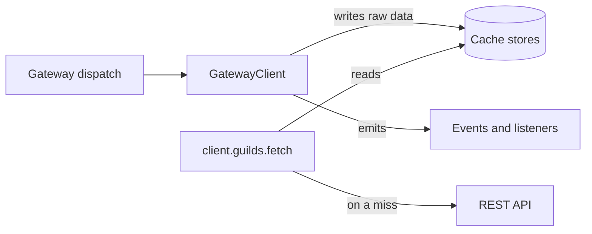

`@wolfstar/plugin-cache` stores the Discord entities your [`GatewayClient`](/guide/going-further/gateway) receives, so managers such as `client.guilds` and `client.members` answer from the cache instead of the REST API. This guide helps you choose between the in-memory and Redis stores, decide what to cache and for how long, keep memory bounded, survive restarts, and handle cache failures.

<Tip>
  **Prerequisites**

- A gateway bot built with `@wolfstar/plugin-gateway`. If you do not have one yet, start with [Build a Gateway Bot](/guide/going-further/gateway).
- Node.js `>=20` for `@wolfstar/plugin-cache`. `@wolfstar/plugin-gateway` itself needs Node.js `>=24.17.0`.
- For the Redis store: a reachable Redis server and the [`ioredis`](https://github.com/redis/ioredis) client.
    </Tip>

## How the cache works

A `Cache` is a plain object holding one `EntityCache` (a store) per Discord entity kind: `cache.guilds`, `cache.users`, `cache.messages`, and so on. Every store is optional. An entity kind without a store is simply not cached.

Stores hold **raw, JSON-serializable API data**, never class instances. Building structures such as `Guild` or `Message` on top of that data is the job of the managers in `@wolfstar/plugin-gateway`. Because stores only hold plain data, the same cache can live in a `Map` or in Redis without changing your call sites.



The `GatewayClient` writes every dispatch into the cache before it emits the matching event, and handles the cascades for you: a `CHANNEL_DELETE` drops that channel's messages, a `GUILD_DELETE` drops every entity of the guild, and reactions and poll votes update the counts of the cached message.

### Entity kinds

The `CacheEntityName` type, and the `CacheEntityNames` constant, list every entity kind a cache can hold:

| Entity kinds                    |                   |                       |
| ------------------------------- | ----------------- | --------------------- |
| `applicationCommandPermissions` | `auditLogEntries` | `autoModerationRules` |
| `bans`                          | `channels`        | `emojis`              |
| `entitlements`                  | `guilds`          | `integrations`        |
| `invites`                       | `members`         | `messages`            |
| `presences`                     | `roles`           | `scheduledEvents`     |
| `soundboardSounds`              | `stageInstances`  | `stickers`            |
| `subscriptions`                 | `threadMembers`   | `threads`             |
| `users`                         | `voiceStates`     |                       |

Guilds are stored without their `roles`, `emojis`, and `stickers` arrays, which live in their own stores.

## Choose a cache mode

`GatewayClient` supports four cache modes. Pick one with the client options:

| Mode                      | Option                               | Where data lives                                        | Reads                      | Best for                                                            |
| ------------------------- | ------------------------------------ | ------------------------------------------------------- | -------------------------- | ------------------------------------------------------------------- |
| Structure cache (default) | none, or `cacheConstructor`          | Process memory, as structure instances patched in place | Synchronous                | Small and medium bots on one process                                |
| In-memory store           | `cache: createInMemoryCache()`       | Process memory, as raw data in `Map`s                   | Synchronous                | Bounding memory with LRU limits and TTLs                            |
| Redis store               | `cache: createRedisCache({ redis })` | Redis, as raw data                                      | Asynchronous               | Large bots, several processes, and resuming sessions after restarts |
| No cache                  | `cache: null`                        | Nowhere                                                 | Every `fetch` hits the API | Interaction-heavy bots that rarely read state                       |

```ts src/bot.ts
import { createInMemoryCache, createRedisCache } from '@wolfstar/plugin-cache';
import { GatewayClient } from '@wolfstar/plugin-gateway';

new GatewayClient({ intents }); // structure cache, in memory
new GatewayClient({ intents, cache: createInMemoryCache() }); // raw data in Maps
new GatewayClient({ intents, cache: createRedisCache({ redis }) }); // raw data in Redis
new GatewayClient({ intents, cache: null }); // nothing is cached
```

With a store (`cache` or `makeCache`), each read builds a new structure from the raw data. With the default structure cache, the cached instance is patched in place by later dispatches, as in discord.js.

<Note>
	The structure cache options (`cacheConstructor`, `cacheOptions`, and `sweepers`) and the store options (`cache` and `makeCache`) exclude each
	other. Combining them throws when you construct the client. With `cache: null`, the structure cache options are ignored.
</Note>

## Install the package

`@wolfstar/plugin-gateway` already depends on `@wolfstar/plugin-cache`. Install it explicitly so you can import the store factories:

<CodeGroup>

```bash npm
npm install @wolfstar/plugin-cache
```

```bash pnpm
pnpm add @wolfstar/plugin-cache
```

```bash yarn
yarn add @wolfstar/plugin-cache
```

```bash bun
bun add @wolfstar/plugin-cache
```

</CodeGroup>

For the Redis store, also install `ioredis`. For the MessagePack codec, install the optional `msgpackr` peer dependency:

<CodeGroup>

```bash npm
npm install ioredis msgpackr
```

```bash pnpm
pnpm add ioredis msgpackr
```

```bash yarn
yarn add ioredis msgpackr
```

```bash bun
bun add ioredis msgpackr
```

</CodeGroup>

## Bound the default structure cache

The default `CollectionCache` keeps every entity the gateway sends until a dispatch such as `MESSAGE_DELETE` or `GUILD_DELETE` removes it. Nothing expires, so messages, users, and presences grow for as long as the process runs.

<Warning>
	On a bot in many guilds, an unbounded default cache is the most common cause of memory growth. Set limits before you go to production.
</Warning>

### Limit each entity with cacheOptions

`cacheOptions` sets a `maxSize` per entity. Once the cache reaches it, it evicts the oldest entry for each new one, and `0` holds nothing. `keepOverLimit(value, key, cache)` protects entries from eviction, like discord.js's `LimitedCollection`: the cache evicts the oldest entry it returns `false` for, and grows past `maxSize` if it keeps them all. `cacheWithLimits` builds `cacheOptions` from plain numbers:

```ts src/bot.ts
import { cacheWithLimits, GatewayClient } from '@wolfstar/plugin-gateway';

const client = new GatewayClient({
	intents,
	// 200 messages, no presences, and up to 1000 members plus the ones in a voice channel.
	cacheOptions: cacheWithLimits({
		messages: 200,
		presences: 0,
		members: { maxSize: 1_000, keepOverLimit: (member) => member.voice?.channelId != null }
	})
});
```

The bound applies to the whole entity, so a busy channel can evict the messages of a quiet one. `client.channels.cache` spans channels and threads, and `maxSize` applies to each of them separately.

### Evict on a timer with sweepers

`sweepers` evict entries every `interval` seconds. Each entity takes either a `lifetime` in seconds, or a `filter` factory that returns the predicate of that sweep (or `null` to skip it). Only `invites`, `messages`, and `threads` take a `lifetime`:

- A message is swept when it was last edited or created longer ago than `lifetime`.
- A thread is swept when it has been archived for longer than `lifetime`.
- An invite is swept when it has expired for longer than `lifetime`.

```ts src/bot.ts
import { DefaultSweeperSettings, GatewayClient, Sweepers } from '@wolfstar/plugin-gateway';

const client = new GatewayClient({
	intents,
	sweepers: {
		...DefaultSweeperSettings,
		users: { interval: 3_600, filter: () => (user) => user.bot },
		members: {
			interval: 3_600,
			filter: Sweepers.filterByLifetime({
				lifetime: 7_200,
				getComparisonTimestamp: (member) => member.joinedTimestamp,
				excludeFromSweep: (member) => member.voice?.channelId != null
			})
		}
	}
});

client.on('cacheSweep', (entity, swept) => console.debug(`Swept ${swept} ${entity}`));

// Sweep on demand. Each method returns how many entries it evicted.
client.sweepers.sweepMessages(600);
```

`DefaultSweeperSettings` sweeps messages untouched for 30 minutes and threads archived for four hours, every hour. A failing filter emits `cacheError` with `operation: "sweep"` instead of throwing, and `client.destroy()` stops the timers.

### Replace the cache class

`cacheConstructor` takes a class that implements `Cache`. The client instantiates it once per entity with `(creator, name, options)`. Extend `CollectionCache` to keep every built-in behavior, for example to apply a default bound to every entity:

```ts src/cache/BoundedCache.ts
import { CollectionCache, type CacheConstructorOptions, type RawAPIType, type StructureCreator, type StructureMixin } from '@wolfstar/plugin-gateway';
import type { CacheEntityName } from '@wolfstar/plugin-cache';

export class BoundedCache<Value extends StructureMixin<object>, Raw extends RawAPIType<Value> = RawAPIType<Value>> extends CollectionCache<
	Value,
	Raw
> {
	public constructor(creator: StructureCreator<Value, Raw>, name: CacheEntityName, options: CacheConstructorOptions<Value, Raw>) {
		super(creator, name, { ...options, maxSize: options.maxSize ?? 10_000 });
	}
}
```

```ts src/bot.ts
new GatewayClient({ intents, cacheConstructor: BoundedCache });
```

The class must be synchronous. A cache that is not a `Map` cannot be enumerated, so it loses the `GUILD_DELETE` and `CHANNEL_DELETE` cascades, the reconciliation of guilds left while offline, the granular emoji and sticker diff events, and `listCached`.

## Use the in-memory store

`createInMemoryCache` returns a `Cache` of `MemoryEntityCache` stores backed by `Map`s. Compared to the default structure cache, it adds least-recently-used eviction, time-to-live per entry, and a periodic sweep of expired entries. Every method stays synchronous.

```ts src/bot.ts
import { createInMemoryCache } from '@wolfstar/plugin-cache';
import { GatewayClient } from '@wolfstar/plugin-gateway';
import { GatewayIntentBits } from 'discord-api-types/v10';

const client = new GatewayClient({
	intents: GatewayIntentBits.Guilds | GatewayIntentBits.GuildMessages,
	cache: createInMemoryCache({
		// Only these entity kinds are cached.
		entities: ['guilds', 'channels', 'roles', 'users', 'members', 'messages'],
		// At most 1000 messages and 50 000 members, the least recently used ones are evicted first.
		maxSize: { messages: 1_000, members: 50_000 },
		// Messages expire one hour after they were written.
		ttl: { messages: 3_600_000 },
		// Drop expired entries every minute.
		sweepInterval: 60_000,
		// Never cache bots.
		policies: { users: { filter: (user) => !user.bot } }
	})
});
```

| Option          | Default           | Description                                                                                                                        |
| --------------- | ----------------- | ---------------------------------------------------------------------------------------------------------------------------------- |
| `entities`      | Every entity kind | The entity kinds to cache. Every other one gets no store.                                                                          |
| `maxSize`       | `Infinity`        | Maximum entries per store before the least recently used ones are evicted. A number for every store, or an object per entity kind. |
| `ttl`           | None              | Default time-to-live of the entries, in **milliseconds**. A number for every store, or an object per entity kind.                  |
| `sweepInterval` | `null`            | How often, in milliseconds, every store drops its expired entries. `null` disables the timer.                                      |
| `policies`      | None              | Per-entity `filter` and `ttl` rules. See [Choose what to cache](#choose-what-to-cache).                                            |

<Note>
	Without `sweepInterval`, an expired entry is only dropped when something reads it, so it still takes memory until then. The sweep timer is
	`unref`'d, so it never keeps the process alive. Call `dispose()` on a `MemoryEntityCache` to stop it.
</Note>

A `get` counts as a use for the least-recently-used order. Invalid `maxSize`, `ttl`, or `sweepInterval` values throw a `RangeError`.

### Build a single store

`MemoryEntityCache` also works on its own, for example inside `makeCache`:

```ts
import { MemoryEntityCache } from '@wolfstar/plugin-cache';

const messages = new MemoryEntityCache(1_000, { ttl: 3_600_000, sweepInterval: 60_000 });

messages.getSize(); // 0
messages.sweep(); // drops expired entries, returns how many
messages.dispose(); // stops the sweep timer
```

The first argument is `maxSize` (`Infinity` by default). The options take `ttl` and `sweepInterval`, both in milliseconds and `null` by default.

## Use the Redis store

The Redis store keeps the cache outside the process. Several processes can share it, a restart keeps it, and memory no longer grows with your guild count. Reads become asynchronous.

<Steps>
  <Step title="Create the store">
    `createRedisCache` takes any client that exposes the commands it needs. An `ioredis` `Redis` or `Cluster` instance works as is:

    ```ts src/cache.ts
    import { createRedisCache } from '@wolfstar/plugin-cache';
    import { Redis } from 'ioredis';

    export const redis = new Redis(process.env.REDIS_URL!);

    export const cache = createRedisCache({
    	redis,
    	prefix: 'my-bot:cache',
    	compression: 'gzip',
    	// Time-to-live in seconds, omitted entity kinds never expire.
    	ttl: { messages: 60 * 60, presences: 10 * 60, users: 24 * 60 * 60 }
    });
    ```

  </Step>
  <Step title="Pass it to the client">
    ```ts src/bot.ts
    import { GatewayClient } from '@wolfstar/plugin-gateway';
    import { GatewayIntentBits } from 'discord-api-types/v10';
    import { cache } from './cache.js';
    
    const client = new GatewayClient({
    	intents: GatewayIntentBits.Guilds | GatewayIntentBits.GuildMembers | GatewayIntentBits.GuildMessages,
    	cache
    });
    
    await client.start({ listen: { port: 8080 } });
    ```
  </Step>
  <Step title="Declare the cache asynchronous">
    With an asynchronous store, the synchronous getters of structures (`member.permissions`, `member.kickable`, `message.deletable`, and others) return promises. Declare it once so TypeScript types them as promises:

    ```ts src/types.d.ts
    declare module '@wolfstar/plugin-gateway' {
    	interface GatewayCacheConfig {
    		asynchronous: true;
    	}
    }

    export {};
    ```

    <Warning>
      Without the declaration, the getters are typed as plain values. A promise is always truthy, so `if (member.kickable)` passes for every member.
    </Warning>

  </Step>
  <Step title="Await your reads">
    Every `manager.cache` method now returns a promise. `await` works with every store, so code that always awaits keeps working if you switch back to memory:

    ```ts src/listeners/automod.ts
    import { EventGatewayListener, type Message } from '@wolfstar/plugin-gateway';

    export class AutomodListener extends EventGatewayListener<'messageCreate'> {
    	public constructor(context: EventGatewayListener.LoaderContext) {
    		super(context, { event: 'messageCreate' });
    	}

    	public override async run(message: Message) {
    		if (!message.guildId) return;

    		const member = await this.container.gatewayClient.guilds.members(message.guildId).cache.get(message.author.id);
    		if (!member) return;

    		if ((await member.permissions).has('ManageMessages')) return;
    		// ...
    	}
    }
    ```

  </Step>
</Steps>

Relation getters such as `message.guild`, `member.voice`, and `channel.parent` stay `null` with an asynchronous store, and never throw. Use the entity fetches instead: `fetchGuild()`, `fetchChannel()`, and `member.fetchPresence()`.

### Redis options

| Option                 | Default            | Description                                                                                            |
| ---------------------- | ------------------ | ------------------------------------------------------------------------------------------------------ |
| `redis`                | Required           | The client to use. Must implement `RedisClientLike`.                                                   |
| `prefix`               | `"wolfstar:cache"` | Prefix of every key. Entries live at `<prefix>:<entity>:<key>`. Exported as `DefaultRedisCachePrefix`. |
| `compression`          | `"none"`           | `"gzip"`, `"brotli"`, or `"none"`.                                                                     |
| `compressionThreshold` | `1024`             | Minimum serialized size, in bytes, for a value to be compressed.                                       |
| `codec`                | `jsonCodec()`      | Encodes and decodes values before compression.                                                         |
| `legacyCodecs`         | `[]`               | Former `codec` values still tagging stored entries.                                                    |
| `ttl`                  | `{}`               | Time-to-live in **seconds**, per entity kind. Omitted ones never expire.                               |
| `indexGuilds`          | `true`             | Keep one index per guild for guild-scoped entity kinds.                                                |
| `entities`             | Every entity kind  | The entity kinds to cache.                                                                             |
| `policies`             | None               | Per-entity `filter` and `ttl` rules.                                                                   |

<Warning>
	Units differ between stores. The Redis `ttl` option is in **seconds**, while the in-memory `ttl` option and every policy `ttl` are in
	**milliseconds**.
</Warning>

### What Redis stores

Each entity kind keeps its values under `<prefix>:<entity>:<key>`, and a sorted set index at `<prefix>:<entity>:@index`. The index serves `keys`, `entries`, `getSize`, and `clear`. A value and its index entry are written and deleted in one `MULTI` transaction, so your client must support `multi()`, which `ioredis` does.

With a `ttl`, every write also prunes the expired index entries, so the index stays bounded even when nothing enumerates it.

To use another Redis client, implement `RedisClientLike`: `get`, `mget`, `set` (with the `"PX"` argument, in milliseconds), `del`, `exists`, `zadd`, `zrem`, `zrange`, `zcard`, `zremrangebyscore`, and `multi()`. The transaction returned by `multi()` (`RedisTransactionLike`) needs `set`, `del`, `zadd`, `zrem`, `zremrangebyscore`, and `exec`.

### Compress large values

`compression` gzip- or brotli-compresses values whose serialized size reaches `compressionThreshold` bytes. Compressed values are tagged, so you can turn compression on or off at any time without breaking the values already stored.

```ts
const cache = createRedisCache({ redis, compression: 'brotli', compressionThreshold: 2_048 });
```

Compression trades CPU for memory and bandwidth. It pays off most on large values such as guilds and messages with embeds.

### Pick a codec

By default, values are JSON (`jsonCodec()`), then optionally compressed. `msgpackCodec()`, from the `@wolfstar/plugin-cache/msgpack` subpath, is denser and still lossless, including for `bigint` and binary values. It needs the optional `msgpackr` peer dependency:

```ts src/cache.ts
import { createRedisCache } from '@wolfstar/plugin-cache';
import { msgpackCodec } from '@wolfstar/plugin-cache/msgpack';

export const cache = createRedisCache({ redis, codec: msgpackCodec() });
```

Encoded values are tagged with the codec's name, so switching **to** a codec never breaks reading entries written with the default `jsonCodec()`. Switching **away** from a non-default codec is different: nothing else records which codec wrote which entry, so list the old codec in `legacyCodecs` to keep reading its entries until they expire:

```ts src/cache.ts
import { createRedisCache, jsonCodec } from '@wolfstar/plugin-cache';
import { msgpackCodec } from '@wolfstar/plugin-cache/msgpack';

export const cache = createRedisCache({ redis, codec: jsonCodec(), legacyCodecs: [msgpackCodec()] });
```

For any other format, implement `CacheCodec`:

```ts
interface CacheCodec {
	readonly name: string;
	encode(value: unknown): Buffer | string;
	decode(data: Buffer | string): unknown;
}
```

The names `"gz"`, `"br"`, and `"b64"` are reserved, because they collide with the compression and raw binary markers. A codec named `"json"` is always treated as the untagged default, whatever its `encode` and `decode` do.

### Index entries by guild

With `indexGuilds` (on by default), the entity kinds that hold guild data (channels, messages, members, roles, and others) also keep one sorted set per guild at `<prefix>:<entity>:@guild:<guildId>`. A `GUILD_DELETE` then reads the guild's keys from it, instead of scanning every entry of every store, which on a large cache means reading and decompressing every stored message.

The price is one more index write per write, and a read before each delete. When the transaction exposes `pexpire` (`ioredis` does), the guild indexes of an entity kind with a `ttl` expire with their entries.

<Note>
	Entries written while `indexGuilds` was off are not indexed. If you turn it on for a populated cache, those entries stay behind on `GUILD_DELETE`
	until they expire or you clear the cache.
</Note>

## Choose what to cache

Caching less is the most effective way to save memory and Redis traffic. Every feature works without a store for an entity kind: every event is still emitted, and the previous state of update and delete events is `null`. A few features need a store:

- Without `emojis` or `stickers`, you only get `guildEmojisUpdate` and `guildStickersUpdate`, instead of the granular emoji and sticker events.
- Without `presences`, `presences.fetch` rejects and `presences.resolve` returns `null`.

### Pick entity kinds

`createInMemoryCache` and `createRedisCache` both take `entities`. Leave out what you never read:

```ts
const cache = createRedisCache({ redis, entities: ['guilds', 'channels', 'roles', 'members', 'users'] });
```

### Filter entries and set TTLs with policies

A `CachePolicy` decides entry by entry:

```ts
interface CachePolicy<Raw> {
	// `false` skips the write and deletes the entry already cached under the key.
	filter?(value: Raw, key: string): boolean;
	// The entry's time-to-live in milliseconds, or `null` for none.
	ttl?(value: Raw, key: string): number | null;
}
```

Because a rejected write also deletes the existing entry, the cache never serves outdated data. Pass policies per entity kind to a store factory, or to the client:

```ts src/bot.ts
import { createInMemoryCache } from '@wolfstar/plugin-cache';
import { GatewayClient } from '@wolfstar/plugin-gateway';

const client = new GatewayClient({
	intents,
	cache: createInMemoryCache(),
	policies: {
		// Never cache bots.
		users: { filter: (user) => !user.bot },
		// Keep messages with attachments for 10 minutes, every other message for an hour.
		messages: { ttl: (message) => (message.attachments.length > 0 ? 600_000 : 3_600_000) }
	}
});
```

The client's `policies` apply to every write in every cache mode, including the default structure cache. A policy `ttl` only applies to stores, since the structure cache has no expiration. To apply a policy to a single store, wrap it with `withPolicy(store, policy)`.

### Choose a store per entity kind

`makeCache` returns a store per entity kind, or `null` not to cache it. It takes precedence over `cache`, and lets you mix stores, for example small and hot entities in memory and messages in Redis:

```ts src/bot.ts
import { MemoryEntityCache, RedisEntityCache } from '@wolfstar/plugin-cache';
import { GatewayClient } from '@wolfstar/plugin-gateway';
import { Redis } from 'ioredis';

const redis = new Redis(process.env.REDIS_URL!);

const client = new GatewayClient({
	intents,
	makeCache: (entity) => {
		if (['guilds', 'channels', 'roles'].includes(entity)) return new MemoryEntityCache();
		if (entity === 'messages') return new RedisEntityCache(redis, { prefix: 'my-bot:cache:messages', ttl: 3_600 });
		return null;
	},
	policies: { roles: { ttl: () => 600_000 } }
});
```

`RedisEntityCache` takes the Redis client and the store's own options: `prefix` (required, the full prefix of this store's keys), `ttl` in seconds, `compression`, `compressionThreshold`, `codec`, `legacyCodecs`, and `guildOf(key, value?)`, which returns the guild of an entry to index it by guild. Without `guildOf`, nothing is indexed by guild, so `GUILD_DELETE` scans the store. `createRedisCache` sets all of this up for you, so prefer it unless you mix stores.

Outside the client, `createCache({ makeCache, policies })` builds the same kind of `Cache`. It calls `makeCache` once per entity kind and returns a frozen cache holding only the stores you returned:

```ts
import { createCache, MemoryEntityCache } from '@wolfstar/plugin-cache';

const cache = createCache({
	makeCache: (entity) => (entity === 'messages' ? null : new MemoryEntityCache()),
	policies: { roles: { ttl: () => 600_000 } }
});
```

<Note>
	Mixing synchronous and asynchronous stores makes some managers synchronous and others asynchronous. Check `manager.cache.synchronous`, or always
	`await` reads.
</Note>

### Cache nothing

`cache: null` caches nothing. `cache.get` returns `undefined` and every `fetch` hits the API. Events are still emitted, with `null` as the previous state of update and delete events. This mode fits bots that mostly answer interactions, since interaction payloads already carry the data they need.

## Read cached data

Managers expose their cache as `manager.cache`. `get` only reads the cache, while `fetch` reads it and falls back to the REST API, caching the result:

```ts
const user = await client.users.cache.get(userId); // undefined on a miss
const guild = await client.guilds.fetch(guildId); // cache first, then the API
const fresh = await client.guilds.fetch(guildId, { force: true }); // always the API
const once = await client.users.fetch(userId, { cache: false }); // do not store the result

await guild.members.cache.get(userId);
await guild.roles.cache.has(roleId);
await client.users.cache.getSize();
```

`manager.cache.synchronous` is `true` with the default structure cache and the in-memory store, and `false` with Redis. A hot path can check it to skip `await`, though `await` works either way.

### Read raw data

`client.cache` is the raw `Cache` behind the managers when you pass `cache` or `makeCache`. Read it when you need the API data itself, for example to forward it to another service without building a structure:

```ts
import { memberKey } from '@wolfstar/plugin-cache';

const rawUser = await client.cache?.users?.get(userId);
const rawMember = await client.cache?.members?.get(memberKey(guildId, userId));
```

Most entities are keyed by their ID. Entities scoped to a guild or a channel use the key helpers the package exports:

| Helper                                                                                                                              | Key of                                                           |
| ----------------------------------------------------------------------------------------------------------------------------------- | ---------------------------------------------------------------- |
| `memberKey(guildId, userId)`                                                                                                        | `members`                                                        |
| `messageKey(channelId, messageId)`                                                                                                  | `messages`                                                       |
| `roleKey`, `emojiKey`, `stickerKey`, `banKey`, `integrationKey`, `scheduledEventKey`, `soundboardSoundKey`, `autoModerationRuleKey` | The matching guild-scoped entity                                 |
| `presenceKey`, `voiceStateKey`                                                                                                      | `presences` and `voiceStates`, by guild and user                 |
| `stageInstanceKey(guildId, channelId)`                                                                                              | `stageInstances`                                                 |
| `threadMemberKey(threadId, userId)`                                                                                                 | `threadMembers`                                                  |
| `inviteKey(guildId, code)`                                                                                                          | `invites`. Pass `null` as `guildId` for invites without a guild. |
| `applicationCommandPermissionsKey(applicationId, guildId, commandId)`                                                               | `applicationCommandPermissions`                                  |
| `guildScopedKey`                                                                                                                    | The generic helper behind the guild-scoped keys                  |

### Fill gaps before synchronous getters

Getters such as `member.permissions`, `member.kickable`, or `channel.permissionsFor(member)` read the cache alone and never call the API. When an entity they need is missing, they throw a `GatewayError` with the code `GuildUncached`, `GuildUncachedMe`, `ChannelUncached`, or `GuildMemberUncached`. If your cache is size-limited or filtered, fetch what is missing first:

```ts
await client.guilds.fetch(guildId);
const me = await client.members.fetchMe(guildId);
await me.roles.fetch();

if (await member.kickable) await member.kick();
```

## Resume sessions across restarts

Without a session store, every deploy or crash identifies every shard again. It spends identify quota, misses the events sent meanwhile, and triggers a full `GUILD_CREATE` burst. `createRedisSessionStore` keeps shard sessions in Redis, so the next process resumes them and Discord replays what it missed.

<Steps>
  <Step title="Create the session store">
    The session store only needs `get`, `set`, and `del`, so it can share the cache's client:

    ```ts src/cache.ts
    import { createRedisCache, createRedisSessionStore } from '@wolfstar/plugin-cache';
    import { Redis } from 'ioredis';

    const redis = new Redis(process.env.REDIS_URL!);

    export const cache = createRedisCache({ redis, prefix: 'my-bot:cache' });
    export const sessionStore = createRedisSessionStore({ redis, prefix: 'my-bot:sessions' });
    ```

  </Step>
  <Step title="Pass both to the client">
    ```ts src/bot.ts
    import { GatewayClient } from '@wolfstar/plugin-gateway';
    import { GatewayIntentBits } from 'discord-api-types/v10';
    import { cache, sessionStore } from './cache.js';
    
    const client = new GatewayClient({
    	intents: GatewayIntentBits.Guilds | GatewayIntentBits.GuildMessages,
    	cache,
    	sessionStore
    });
    ```

    Pair the session store with a persistent cache. A resumed session only replays missed events, not guilds, so a process that resumes with an empty in-memory cache never gets its guilds back.

  </Step>
  <Step title="Shut down resumably">
    By default, `destroy()` closes connections with code `1000`, which makes Discord invalidate the sessions. With `resumable: true`, shards close with code `4200` and their sessions stay stored:

    ```ts src/bot.ts
    process.once('SIGTERM', async () => {
    	await client.destroy({ resumable: true });
    	process.exit(0);
    });
    ```

  </Step>
</Steps>

| Option   | Default               | Description                                                                                                       |
| -------- | --------------------- | ----------------------------------------------------------------------------------------------------------------- |
| `redis`  | Required              | The client to use. Needs `get`, `set`, and `del`.                                                                 |
| `prefix` | `"wolfstar:sessions"` | Prefix of every key. Sessions live at `<prefix>:<shardId>` as JSON. Exported as `DefaultRedisSessionStorePrefix`. |
| `ttl`    | `600`                 | Seconds a session is kept after its last write. `null` keeps it until it is dropped.                              |

Discord only lets a session be resumed for a while after its connection closes. The `ttl` spares a restart the attempt to resume a session long gone, and keeps Redis tidy. Each write pushes the expiration back, and the gateway writes on every dispatch, so only a shard that receives no dispatch for longer than the `ttl` identifies on the next restart.

How the client uses the store:

- **Reads never stall a shard.** Each shard reads the store once when it first connects. A read that fails or takes longer than `sessionStoreTimeout` (5 seconds by default) is reported as a `GatewaySessionStoreError` through `error`, and the shard identifies. A stored value that is not valid JSON rejects with a `CacheValueError`.
- **Writes run in the background.** After a crash, the stored sequence may be a few dispatches behind. Discord replays those dispatches, so listeners can see them twice. Make listeners that write to a database idempotent.
- `sessionStore` replaces the `gateway.retrieveSessionInfo` and `gateway.updateSessionInfo` options. Passing either alongside it throws.

Any object that implements `GatewaySessionStore` works, for example to keep sessions in your own database:

```ts
interface GatewaySessionStore {
	get(shardId: number): Awaitable<GatewaySessionInfo | null>;
	// `null` once the session can no longer be resumed.
	set(shardId: number, info: GatewaySessionInfo | null): Awaitable<void>;
}
```

`GatewaySessionInfo` has the same shape as the `SessionInfo` of `@discordjs/ws`.

## Handle cache failures

A remote store can fail: Redis restarts, the network drops, or a value cannot be decoded. Two options decide what happens, and both report the error.

| Option         | Applies to                                                | `"miss"` / `"skip"` (default)                                                     | Alternative                                                                                      |
| -------------- | --------------------------------------------------------- | --------------------------------------------------------------------------------- | ------------------------------------------------------------------------------------------------ |
| `cacheErrors`  | Manager reads and writes, such as `cache.get` and `fetch` | Treat the failure as a cache miss, falling back to the API or to the data at hand | `"throw"` rejects with the error                                                                 |
| `cacheFailure` | Dispatches written by the gateway                         | Drop the event, so listeners never see state the cache does not hold              | `"emitUncached"` emits the event built from the payload alone, with `null` as the previous state |

Manager failures are emitted as `cacheError`, with a context that names the store, the key, and the operation. Dispatch failures are reported through the `error` event, or the logger when nothing listens to it:

```ts src/bot.ts
import { CacheValueError } from '@wolfstar/plugin-cache';

client.on('cacheError', (error, { entity, key, operation }) => {
	console.warn(`Cache ${operation} failed on ${entity}${key ? ` (${key})` : ''}`, error);
});

client.on('error', (error) => {
	if (error instanceof CacheValueError) console.error(`Unreadable cache value at ${error.key}`, error.cause);
	else console.error(error);
});
```

`CacheErrorContext.operation` is one of `get`, `set`, `upsert`, `delete`, `has`, `clear`, `getSize`, `keys`, `entries`, or `sweep`. `key` is `null` for operations that do not target one entry.

The Redis store distinguishes three cases:

- A missing value is not an error: `get` resolves to `undefined`.
- A value that cannot be read back (invalid JSON, or bytes that fail to decompress) rejects with a `CacheValueError`, with the Redis `key` and the original error as `cause`. Its message reads `Cannot read the cached value at "<key>"`.
- Connection errors are not wrapped. They propagate as the client throws them.

<Tip>
	Choose `cacheFailure: "emitUncached"` when missing an event is worse than handling a `null` previous state, for example for moderation logs. Keep
	the default `"skip"` when listeners rely on cached state.
</Tip>

## Use the cache without GatewayClient

The cache does not depend on `@wolfstar/plugin-gateway`. You can fill it from any gateway connection, for example a raw `@discordjs/ws` `WebSocketManager`.

### Attach to a gateway

`attachCacheToGateway(gateway, cache, options)` listens to the gateway's `dispatch` event, writes each dispatch, and returns a function that detaches it. Any object with `on('dispatch', listener)` works, and `off` is used to detach when present:

```ts src/gateway.ts
import { attachCacheToGateway, createInMemoryCache } from '@wolfstar/plugin-cache';
import { REST } from '@discordjs/rest';
import { WebSocketManager } from '@discordjs/ws';
import { GatewayIntentBits } from 'discord-api-types/v10';

const rest = new REST().setToken(process.env.DISCORD_TOKEN!);
const gateway = new WebSocketManager({
	token: process.env.DISCORD_TOKEN!,
	intents: GatewayIntentBits.Guilds | GatewayIntentBits.GuildMessages,
	rest
});

const cache = createInMemoryCache({ maxSize: { messages: 1_000 } });
const detach = attachCacheToGateway(gateway, cache, {
	clientUserId: process.env.BOT_ID,
	onError: (error, payload, shardId) => console.error(`Failed to cache ${payload.t} on shard ${shardId}`, error)
});

await gateway.connect();

const guild = await cache.guilds?.get(guildId);
```

Without `onError`, failures are logged with `console.error('Failed to cache gateway dispatch', error)`. Pass the bot's user ID as `clientUserId` so reactions and poll votes set the `me` and `me_voted` flags of cached messages.

<Warning>
	`attachCacheToGateway` writes each dispatch as soon as it arrives and does not queue them. With an asynchronous store, two writes for the same
	entity can land out of order. `GatewayClient` orders dispatches per guild, so prefer it when you use Redis.
</Warning>

### Apply dispatches yourself

`applyGatewayDispatch(cache, payload, context)` writes one dispatch and resolves to one result per entry written or deleted: `{ entity, key, type, existing, added }`. `existing` gives you the previous state without a second read:

```ts
import { applyGatewayDispatch } from '@wolfstar/plugin-cache';

gateway.on('dispatch', async (payload) => {
	const results = await applyGatewayDispatch(cache, payload, { clientUserId: botId });
	for (const { entity, key, type, existing } of results) {
		if (entity === 'members' && type === 'delete') console.log(`Member left: ${key}`, existing);
	}
});
```

`applyGatewayDispatch` is `createCacheOperations` followed by `applyCacheOperations`. Call them separately to inspect or filter the writes:

```ts
import { applyCacheOperations, createCacheOperations } from '@wolfstar/plugin-cache';

// Pure: turns a dispatch into a list of operations, without touching any store.
const operations = createCacheOperations(payload, { clientUserId: botId });

// Never write presences, whatever the store holds.
await applyCacheOperations(
	cache,
	operations.filter((operation) => operation.store !== 'presences')
);
```

Each `CacheOperation` is one of:

| Type           | Fields                                  | Effect                                                                                    |
| -------------- | --------------------------------------- | ----------------------------------------------------------------------------------------- |
| `upsert`       | `store`, `key`, `raw`, `merge?`         | Writes `raw`, shallow-merged onto the existing value when `merge` is set                  |
| `update`       | `store`, `key`, `update(value)`         | Computes the new value from the cached one. Nothing is written when the key is not cached |
| `delete`       | `store`, `key`                          | Deletes one entry                                                                         |
| `deletePrefix` | `store`, `prefix`, `guildId?`           | Deletes every entry whose key starts with `prefix`                                        |
| `deleteWhere`  | `store`, `predicate(value)`, `guildId?` | Deletes every entry the predicate matches                                                 |

`applyCacheOperations` runs operations in order, skips stores the cache does not hold, and skips the scans of `deletePrefix` and `deleteWhere` on stores that cannot enumerate their entries. `createCacheOperations` ignores `INTERACTION_CREATE`. A reaction or vote on a message the cache does not hold is ignored, since there is nothing to count it into.

## Write a custom store

Implement `EntityCache` to keep entities anywhere: another key-value database, a tiered cache, or a store that records metrics. Every method may return a promise.

```ts
interface EntityCache<Raw> {
	// Optional: `true` when no method ever returns a promise.
	readonly synchronous?: boolean;
	get(key: string): Awaitable<Raw | undefined>;
	// `ttl` in milliseconds, `null` for none, `undefined` for the store's default.
	set(key: string, value: Raw, options?: { ttl?: number | null }): Awaitable<void>;
	// Shallow-merges `data` into the entry unless `overwrite`, and returns both.
	upsert(key: string, data: Partial<Raw>, options?: { overwrite?: boolean; ttl?: number | null }): Awaitable<{ existing?: Raw; added: Raw }>;
	has(key: string): Awaitable<boolean>;
	delete(key: string): Awaitable<boolean>;
	clear(): Awaitable<void>;
	getSize(): Awaitable<number>;
	// Optional: `null` when the store does not index its entries by guild.
	deleteGuild?(guildId: string): Awaitable<number | null>;
}

// Optional extension, detected with `isIterableCache`.
interface IterableEntityCache<Raw> extends EntityCache<Raw> {
	keys(): Awaitable<string[]>;
	values(): Awaitable<Raw[]>;
	entries(): Awaitable<[key: string, value: Raw][]>;
}
```

This store wraps a `Map` and counts hits and misses. It ignores `ttl`, which the interface allows:

```ts src/cache/CountingStore.ts
import type { IterableEntityCache } from '@wolfstar/plugin-cache';

export class CountingStore<Raw extends object> implements IterableEntityCache<Raw> {
	public readonly synchronous = true;
	public hits = 0;
	public misses = 0;
	readonly #map = new Map<string, Raw>();

	public get(key: string) {
		const value = this.#map.get(key);
		if (value === undefined) this.misses++;
		else this.hits++;
		return value;
	}

	public set(key: string, value: Raw) {
		this.#map.set(key, value);
	}

	public upsert(key: string, data: Partial<Raw>, options?: { overwrite?: boolean }) {
		const existing = this.#map.get(key);
		const added = (options?.overwrite || existing === undefined ? data : { ...existing, ...data }) as Raw;
		this.#map.set(key, added);
		return { existing, added };
	}

	public has(key: string) {
		return this.#map.has(key);
	}

	public delete(key: string) {
		return this.#map.delete(key);
	}

	public clear() {
		this.#map.clear();
	}

	public getSize() {
		return this.#map.size;
	}

	public keys() {
		return [...this.#map.keys()];
	}

	public values() {
		return [...this.#map.values()];
	}

	public entries() {
		return [...this.#map.entries()];
	}
}
```

```ts src/bot.ts
import { CountingStore } from './cache/CountingStore.js';

const client = new GatewayClient({
	intents,
	makeCache: (entity) => (entity === 'presences' ? null : new CountingStore())
});
```

Keep these rules in mind:

- **Set `synchronous` honestly.** An `Awaitable` cannot be told apart from a promise without calling the method, so the client relies on `synchronous` to read without awaiting. A store that leaves it out is treated as asynchronous. `MemoryEntityCache` sets it to `true`, and `RedisEntityCache` to `false`.
- **Enumeration is optional.** A remote store may not enumerate cheaply. Without `keys`, `values`, and `entries`, the store is not scanned on `GUILD_DELETE` and `CHANNEL_DELETE`, so its entries for that guild stay until they expire. `keys`, `values`, and `entries` return snapshots, not live iterators.
- **Implement `deleteGuild` to skip scans.** When it resolves to a number, `GUILD_DELETE` skips the scan of that store. Resolving to `null` falls back to the scan.
- **Store plain data.** Values must stay JSON-serializable, since the managers build structures from them.

## Troubleshooting

<AccordionGroup>
  <Accordion title="Memory keeps growing">
    The default structure cache never expires entries. Add `cacheOptions` limits with `cacheWithLimits` and enable `sweepers` (for example `DefaultSweeperSettings`), or switch to `createInMemoryCache` with `maxSize` and `ttl`. Leave out entity kinds you never read, such as `presences`, and filter bots with a `users` policy.
  </Accordion>

<Accordion title="Constructing the client throws about cache options">
	`cacheConstructor`, `cacheOptions`, and `sweepers` only apply to the default structure cache. Combining them with `cache` or `makeCache` throws.
	With a store, use the store's `maxSize` and `ttl`, or policy `ttl`s, instead.
</Accordion>

<Accordion title="if (member.kickable) is always true">
	You use an asynchronous store, such as Redis, without the `GatewayCacheConfig` declaration. The getter returns a promise, which is always truthy.
	Add the declaration from [Use the Redis store](#use-the-redis-store) and `await` the getter.
</Accordion>

<Accordion title="A getter throws GuildUncached or GuildMemberUncached">
	The getter needs an entity your cache does not hold, because it is filtered, evicted, or not cached at all. Fetch the guild, the bot's member, and
	its roles first, as shown in [Fill gaps before synchronous getters](#fill-gaps-before-synchronous-getters).
</Accordion>

  <Accordion title="Entries never expire in Redis">
    Check the units: the Redis `ttl` option is in seconds, so `ttl: { messages: 3_600_000 }` keeps messages for more than 41 days. Policy `ttl`s, on the other hand, are in milliseconds.
  </Accordion>

<Accordion title="CacheValueError after changing the codec">
	You switched away from a non-default codec. Add the old codec to `legacyCodecs` so existing entries can still be decoded, or clear the cache.
</Accordion>

<Accordion title="Entries of a deleted guild stay in Redis">
	Entries written while `indexGuilds` was off are not indexed by guild. They stay until they expire or you clear the cache. Set a `ttl` on large
	entity kinds such as `messages` so leftovers expire on their own.
</Accordion>

  <Accordion title="A restarted process identifies instead of resuming">
    Check that you shut down with `client.destroy({ resumable: true })`, that the restart happens before the session store `ttl` runs out, and that `error` reports no `GatewaySessionStoreError`. A plain `destroy()` invalidates the sessions.
  </Accordion>
</AccordionGroup>

## Stars module

On framework 6.1 and later, list the `./module` entry in `modules` in `stars.config` to add the package to the auto imports. It needs the optional [`@wolfstar/kit`](/documentation/packages/kit) peer dependency:

```ts stars.config.ts
export default defineConfig({
	modules: ['@wolfstar/plugin-gateway/module', '@wolfstar/plugin-cache/module']
});
```

The module registers no plugin and takes no options. You still create the cache and pass it to the `GatewayClient` yourself.

## Related pages

<CardGroup cols={2}>
  <Card title="Build a Gateway Bot" icon="tower-broadcast" href="/guide/going-further/gateway">
    Set up a GatewayClient, listeners, managers, and production shutdown.
  </Card>

<Card title="Scale with plugin-sharder" icon="arrows-split-up-and-left" href="/guide/going-further/sharding">
	Spread shards across processes and machines that share one Redis cache.
</Card>

<Card title="plugin-cache reference" icon="book" href="/documentation/packages/plugin-cache">
	Package overview, installation, and Redis options.
</Card>

  <Card title="plugin-gateway reference" icon="book-open" href="/documentation/packages/plugin-gateway">
    Every client option, manager, structure, event, and error.
  </Card>
</CardGroup>
