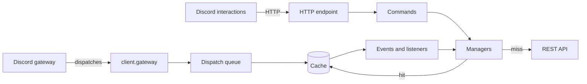

`@wolfstar/plugin-gateway` turns a `@wolfstar/http-framework` bot into a full gateway bot. Its `GatewayClient` keeps your HTTP interactions endpoint, connects to the Discord gateway over WebSocket, caches what Discord sends, and emits typed events you can handle with listener pieces. This guide walks you from an HTTP only bot to a production ready gateway bot, covering intents, events, managers, partials, presence, monitoring, and graceful restarts.

<Tip>
  **Prerequisites**

- A bot built with [`@wolfstar/http-framework`](/documentation/packages/http-framework) 3.4, 5, or 6. Follow the [commands guide](/getting-started/commands) first if you are starting from scratch.
- Node.js `24.17.0` or later. The package is built on the `@discordjs/structures` snapshots, which need it.
- `DISCORD_TOKEN` and `DISCORD_PUBLIC_KEY` set in your [environment](/getting-started/environment). The client reads both automatically.
- A host that keeps a process running. The gateway is a persistent WebSocket connection, so serverless platforms that stop between requests cannot run it.

</Tip>

## How the gateway client works

`GatewayClient` extends the framework's `Client`, so everything you already have keeps working: commands, components, and autocomplete are still served by the HTTP endpoint. On top of that, the client opens a gateway connection and processes every dispatch Discord sends:



| Piece                  | What it gives you                                                                                                                                                      |
| ---------------------- | ---------------------------------------------------------------------------------------------------------------------------------------------------------------------- |
| `GatewayClient`        | The framework `Client` plus a gateway connection, a cache, managers, and gateway events.                                                                               |
| `client.gateway`       | The `@discordjs/ws` `WebSocketManager` that runs the shards.                                                                                                           |
| `client.api`           | The `@discordjs/core` API, for REST calls the managers do not wrap.                                                                                                    |
| Managers               | `client.users`, `client.guilds`, `client.channels`, `client.threads`, `client.messages`, `client.members`, and `client.roles` read the cache and fall back to the API. |
| Structures             | Classes such as `Guild`, `GuildMember`, `Message`, and `TextChannel`, with discord.js style methods like `reply`, `react`, and `send`.                                 |
| `EventGatewayListener` | A listener piece for gateway events, loaded from your `listeners` directory like any other piece.                                                                      |

<Note>
	Interactions keep arriving through your HTTP endpoint. The gateway client does not process `INTERACTION_CREATE` dispatches, and interaction
	payloads do not go through the managers or the cache.
</Note>

## Install the package

Install `@wolfstar/plugin-gateway` together with `@wolfstar/plugin-cache`, which provides the cache engine:

<CodeGroup>

```bash npm
npm install @wolfstar/plugin-gateway @wolfstar/plugin-cache
```

```bash pnpm
pnpm add @wolfstar/plugin-gateway @wolfstar/plugin-cache
```

```bash yarn
yarn add @wolfstar/plugin-gateway @wolfstar/plugin-cache
```

```bash bun
bun add @wolfstar/plugin-gateway @wolfstar/plugin-cache
```

</CodeGroup>

The examples in this guide import `GatewayIntentBits` and other enums from `discord-api-types/v10`. Add `discord-api-types` to your dependencies if your project does not list it already.

<Note>
	The package also exposes `@wolfstar/plugin-gateway/register`. Importing it does nothing: `GatewayClient` is a client class, not a plugin you
	register. It exists so `stars add` and plugin lists keep working.
</Note>

## Build your first gateway bot

<Steps>
  <Step title="Replace the client">
    In your entry file, create a `GatewayClient` instead of a `Client`. It accepts every framework option, plus the gateway options described in the [options reference](#options-reference):

    ```ts src/bot.ts
    import { GatewayClient } from '@wolfstar/plugin-gateway';
    import { GatewayIntentBits } from 'discord-api-types/v10';

    const client = new GatewayClient({
    	intents: GatewayIntentBits.Guilds | GatewayIntentBits.GuildMessages | GatewayIntentBits.MessageContent
    });
    ```

    `intents` is the only option you must think about: it decides which events Discord sends. See [choose your intents](#choose-your-intents).

  </Step>
  <Step title="Enable privileged intents">
    `GuildMembers`, `GuildPresences`, and `MessageContent` are privileged. Open your application in the [Discord Developer Portal](https://discord.com/developers/applications), go to **Bot**, and turn on each privileged intent you request under **Privileged Gateway Intents**. Discord closes the connection when you request a privileged intent that is not enabled there.
  </Step>
  <Step title="Add a listener">
    Create a listener piece in `src/listeners/`. `EventGatewayListener` takes the event name as a type parameter, so `run` receives correctly typed arguments:

    ```ts src/listeners/ping.ts
    import { EventGatewayListener, RegisterAsGatewayListener, type Message } from '@wolfstar/plugin-gateway';

    @RegisterAsGatewayListener('messageCreate')
    export class PingListener extends EventGatewayListener<'messageCreate'> {
    	public override async run(message: Message) {
    		if (message.author.bot) return;
    		if (message.content === '!ping') await message.reply('Pong!');
    	}
    }
    ```

  </Step>
  <Step title="Start the bot">
    `start` loads your pieces, starts the HTTP server, and connects to the gateway. `listen` is required because the HTTP endpoint keeps serving interactions:

    ```ts src/bot.ts
    client.on('clientReady', (ready) => console.log(`Logged in as ${ready.user?.username}`));

    await client.start({ listen: { port: 3000 } });
    ```

    `start({ listen, load })` is a shortcut for `await client.load(load)`, `await client.listen(listen)`, and `await client.connect()`. Call them yourself when you need to run code between the steps.

  </Step>
</Steps>

Put together, the entry file looks like this:

```ts src/bot.ts expandable
import { GatewayClient } from '@wolfstar/plugin-gateway';
import { GatewayIntentBits } from 'discord-api-types/v10';

const client = new GatewayClient({
	intents: GatewayIntentBits.Guilds | GatewayIntentBits.GuildMessages | GatewayIntentBits.MessageContent
});

client.on('clientReady', (ready) => console.log(`Logged in as ${ready.user?.username}`));
client.on('error', (error) => console.error(error));

await client.start({ listen: { port: 3000 } });
```

Send `!ping` in a channel the bot can see and it answers `Pong!`. Your slash commands keep working through the HTTP endpoint.

## Choose your intents

Intents are bit flags that subscribe the connection to groups of events. Request only what you use: every intent adds traffic, cache writes, and memory. Combine them with `|`:

| Intent                                                                                  | Events it enables                                                                                                          |
| --------------------------------------------------------------------------------------- | -------------------------------------------------------------------------------------------------------------------------- |
| `Guilds`                                                                                | `guildCreate`, `guildUpdate`, `guildDelete`, role, channel, thread, and stage instance events. Almost every bot needs it.  |
| `GuildMembers` (privileged)                                                             | `guildMemberAdd`, `guildMemberUpdate`, `guildMemberRemove`, `threadMembersUpdate`, and requesting every member of a guild. |
| `GuildModeration`                                                                       | `guildBanAdd`, `guildBanRemove`, and `guildAuditLogEntryCreate`.                                                           |
| `GuildExpressions`                                                                      | Emoji, sticker, and soundboard sound events.                                                                               |
| `GuildIntegrations`                                                                     | `guildIntegrationsUpdate` and integration events.                                                                          |
| `GuildInvites`                                                                          | `inviteCreate` and `inviteDelete`.                                                                                         |
| `GuildVoiceStates`                                                                      | `voiceStateUpdate`. Also fills `guild.voiceStates`.                                                                        |
| `GuildPresences` (privileged)                                                           | `presenceUpdate`. Also fills `guild.presences`.                                                                            |
| `GuildMessages`                                                                         | Message events in guilds.                                                                                                  |
| `GuildMessageReactions`                                                                 | Reaction events in guilds.                                                                                                 |
| `GuildMessageTyping`                                                                    | `typingStart` in guilds.                                                                                                   |
| `GuildMessagePolls`                                                                     | `messagePollVoteAdd` and `messagePollVoteRemove` in guilds.                                                                |
| `DirectMessages`, `DirectMessageReactions`, `DirectMessageTyping`, `DirectMessagePolls` | The same events for direct messages.                                                                                       |
| `MessageContent` (privileged)                                                           | The content, embeds, attachments, and components of messages that do not mention the bot.                                  |
| `GuildScheduledEvents`                                                                  | Scheduled event events, including user add and remove.                                                                     |
| `AutoModerationConfiguration`                                                           | `autoModerationRuleCreate`, `autoModerationRuleUpdate`, and `autoModerationRuleDelete`.                                    |
| `AutoModerationExecution`                                                               | `autoModerationActionExecution`.                                                                                           |

<Warning>
	Without `MessageContent`, `message.content` is an empty string for most messages. Without `GuildMembers`, member join and leave events never
	arrive. Both are privileged and must also be enabled in the Developer Portal.
</Warning>

## Listen to events

### Listener pieces

Listener pieces live in `src/listeners/` and are loaded by `client.load()` (or `client.start()`). Pass the event in the constructor, or use the `RegisterAsGatewayListener` decorator to skip the constructor entirely:

<Tabs>
  <Tab title="Decorator">
    ```ts src/listeners/welcome.ts
    import { EventGatewayListener, RegisterAsGatewayListener, type GuildMember } from '@wolfstar/plugin-gateway';
    
    @RegisterAsGatewayListener('guildMemberAdd')
    export class WelcomeListener extends EventGatewayListener<'guildMemberAdd'> {
    	public override async run(member: GuildMember) {
    		await member.roles.add(process.env.MEMBER_ROLE_ID!, 'Joined the server');
    		await this.container.gatewayClient.users.send(member, 'Welcome to the pack!');
    	}
    }
    ```
  </Tab>
  <Tab title="Constructor">
    ```ts src/listeners/welcome.ts
    import { EventGatewayListener, type GuildMember } from '@wolfstar/plugin-gateway';
    
    export class WelcomeListener extends EventGatewayListener<'guildMemberAdd'> {
    	public constructor(context: EventGatewayListener.LoaderContext) {
    		super(context, { event: 'guildMemberAdd' });
    	}
    
    	public override async run(member: GuildMember) {
    		await member.roles.add(process.env.MEMBER_ROLE_ID!, 'Joined the server');
    		await this.container.gatewayClient.users.send(member, 'Welcome to the pack!');
    	}
    }
    ```
  </Tab>
</Tabs>

The decorator's second argument takes the remaining listener options, for example `@RegisterAsGatewayListener('clientReady', { once: true })` to run a listener a single time.

### Inline listeners

For quick handlers, or code that lives next to the client, attach listeners directly. Every event is typed, and the `GatewayEvents` enum holds the same names if you prefer constants:

```ts src/bot.ts
import { GatewayEvents } from '@wolfstar/plugin-gateway';

client.on('guildCreate', (guild) => console.log(`Joined ${guild.name}`));
client.on(GatewayEvents.MessageCreate, (message) => console.log(message.content));
```

### Update and delete events

Update events pass the previous state first. It comes from the cache, so it is `null` when the entity was not cached before the change. Delete events pass the cached entity (or `null`) and the raw dispatch data, which always identifies what was removed:

```ts src/listeners/messageLog.ts
import { RegisterAsGatewayListener, EventGatewayListener, type Message } from '@wolfstar/plugin-gateway';
import type { GatewayMessageDeleteDispatchData } from 'discord-api-types/v10';

@RegisterAsGatewayListener('messageDelete')
export class MessageLogListener extends EventGatewayListener<'messageDelete'> {
	public override run(message: Message | null, data: GatewayMessageDeleteDispatchData) {
		if (message === null) {
			console.log(`Uncached message ${data.id} deleted in ${data.channel_id}`);
			return;
		}

		console.log(`${message.author.username}'s message was deleted: ${message.content}`);
	}
}
```

<Tip>
	`guildDelete` also fires when a guild becomes unavailable during a Discord outage. Check `data.unavailable` before treating it as the bot leaving:
	when it is `true`, the guild comes back later with a `guildCreate`.
</Tip>

### Wait until the client is ready

`clientReady` fires once every shard is ready and the guilds Discord announced in `READY` have arrived (or `waitGuildTimeout` expired). Check readiness elsewhere with `client.isClientReady()`, and read `client.clientReadyAt` for the time it happened. Each shard also emits `shardReady(shardId, user)` when its own session starts.

On `READY`, guilds the bot left while it was offline are emitted as `guildDelete`, so your cleanup logic runs for them too.

### Raw dispatches

Two low level events expose every dispatch:

| Event                               | When it fires                                                                                                         |
| ----------------------------------- | --------------------------------------------------------------------------------------------------------------------- |
| `raw(payload, shardId)`             | Before the client processes the dispatch.                                                                             |
| `dispatch(payload, shardId, state)` | After the dispatch is written to the cache. Not emitted for `INTERACTION_CREATE` or for dispatches that were dropped. |

Use them for metrics or to handle dispatch types the client has no event for.

### Dispatch ordering

Dispatches for the same guild, or the same direct message channel, are processed in order: an event never overtakes one that arrived before it for the same guild. Dispatches that belong to no guild wait for everything already queued on their shard. Listeners for different guilds run concurrently.

`client.queueStats` returns `{ pending, partitions }`, the number of dispatches waiting and the number of guild or channel queues, which makes a good health metric.

## Use Discord data in commands

Pieces reach the gateway client through `this.container.gatewayClient`, typed as `GatewayClient`. `this.container.client` stays typed as the base `Client`:

```ts src/commands/server.ts
import { Command, RegisterCommand } from '@wolfstar/http-framework';

@RegisterCommand((builder) => builder.setName('server').setDescription('Shows information about this server'))
export class ServerCommand extends Command {
	public override async chatInputRun(interaction: Command.ChatInputInteraction) {
		const guild = await this.container.gatewayClient.guilds.fetch(interaction.guildId!);
		return interaction.reply({ content: `${guild.name} has ${guild.memberCount ?? 'an unknown number of'} members.` });
	}
}
```

Outside pieces, for example in a utility module, call `getGatewayClient()`:

```ts src/lib/guilds.ts
import { getGatewayClient } from '@wolfstar/plugin-gateway';

export function getGuildName(guildId: string) {
	return getGatewayClient().guilds.cache.get(guildId)?.name ?? null;
}
```

Or use `container`

```ts src/lib/guilds.ts
import { container } from '@sapphire/pieces';

export function getGuildName(guildId: string) {
	return container.guilds.cache.get(guildId)?.name ?? null;
}
```

## Read and fetch entities

Each manager reads its cache first and falls back to the Discord API:

| Manager           | Keyed by                      |
| ----------------- | ----------------------------- |
| `client.users`    | User ID                       |
| `client.guilds`   | Guild ID                      |
| `client.channels` | Channel ID, including threads |
| `client.threads`  | Thread ID                     |
| `client.messages` | Channel ID and message ID     |
| `client.members`  | Guild ID and user ID          |
| `client.roles`    | Guild ID and role ID          |

Pick the method by how fresh the data must be:

| Method                            | Behavior                                                                                                                                                      |
| --------------------------------- | ------------------------------------------------------------------------------------------------------------------------------------------------------------- |
| `cache.get(...)`                  | Reads the cache only. Returns `undefined` on a miss. Never calls the API.                                                                                     |
| `fetch(...)`                      | Returns the cached entity, or requests it and caches the result. Pass `{ force: true }` to skip the cache, or `{ cache: false }` to avoid storing the result. |
| `refresh(...)`                    | Always requests the entity and updates the cache.                                                                                                             |
| `resolve(...)` / `resolveId(...)` | Turn a structure or an ID into the cached structure or its ID.                                                                                                |

```ts src/lib/lookup.ts
import { getGatewayClient } from '@wolfstar/plugin-gateway';

const client = getGatewayClient();

// Cache only: instant, may be undefined.
const cached = client.guilds.cache.get(guildId);

// Cache first, then the API.
const member = await client.members.fetch(guildId, userId);

// Always the API, for data that must be current.
const fresh = await client.members.fetch(guildId, userId, { force: true });

// The bot's own member in a guild.
const me = client.members.me(guildId) ?? (await client.members.fetchMe(guildId));
```

```ts src/lib/lookup.ts
import { getGatewayClient } from '@wolfstar/plugin-gateway';

const client = getGatewayClient();

// Cache only: instant, may be undefined.
const cached = client.guilds.cache.get(guildId);

// Cache first, then the API.
const member = await guild.members.fetch(userId);

// Always the API, for data that must be current.
const fresh = await guild.members.fetch(userId, { force: true });

// The bot's own member in a guild.
const me = guild.members.me(guildId) ?? (await guild.members.fetchMe());
```

### Guild scoped managers

Structures expose managers scoped to them, so you do not repeat IDs: `guild.members`, `guild.roles`, `guild.voiceStates`, `guild.presences`, `channel.messages`, and `thread.members`. `guild.members.me` returns the bot's cached member, and `client.guilds.members(guildId)` gives you a guild's member manager without fetching the guild.

### Relations

Relations such as `message.member`, `message.guild`, and `channel.guild` are read from the cache and are `null` when the related entity is not cached. When you need it regardless, call the async variant, such as `message.fetchGuild()` or `message.fetchChannel()`:

```ts
const guild = message.guild ?? (await message.fetchGuild());
```

### Synchronous getters

Getters that compute from several entities, such as `member.permissions`, `member.permissionsIn(channel)`, `member.kickable`, `member.bannable`, `member.moderatable`, `member.manageable`, `member.displayColor`, `message.editable`, `message.deletable`, and `channel.permissionsFor(member)`, need their inputs in the cache. When one is missing, they throw a `GatewayError` with a code such as `GuildUncached`, `GuildUncachedMe`, `ChannelUncached`, or `GuildMemberUncached`.

Fetch what the getter needs first:

```ts src/lib/moderation.ts
import { getGatewayClient } from '@wolfstar/plugin-gateway';

export async function canKick(guildId: string, userId: string) {
	const client = getGatewayClient();
	await client.guilds.fetch(guildId);
	await client.members.fetchMe(guildId);
	const member = await client.members.fetch(guildId, userId);
	return member.kickable;
}
```

<Warning>
	With an asynchronous cache store such as Redis, getters return promises. Declare it once with a `GatewayCacheConfig` augmentation so TypeScript
	makes you `await` them. The [caching guide](/guide/going-further/caching#use-the-redis-store) shows how.
</Warning>

## Take actions

Structures and managers wrap the common REST calls:

```ts src/listeners/automod.ts
import { EventGatewayListener, RegisterAsGatewayListener, type Message } from '@wolfstar/plugin-gateway';

const blocked = ['free nitro', 'discord.gift/'];

@RegisterAsGatewayListener('messageCreate')
export class AutomodListener extends EventGatewayListener<'messageCreate'> {
	public override async run(message: Message) {
		if (!message.inGuild() || message.author.bot) return;

		const content = message.content.toLowerCase();
		if (!blocked.some((phrase) => content.includes(phrase))) return;

		await message.delete('Blocked phrase');
		await this.container.gatewayClient.users.send(message.author, 'Your message was removed because it contained a blocked phrase.');
	}
}
```

Other actions follow the same pattern:

| Goal                  | Code                                                              |
| --------------------- | ----------------------------------------------------------------- |
| Reply to a message    | `await message.reply('Done!')`                                    |
| React to a message    | `await message.react('👍')`                                       |
| Send to a channel     | `if (channel instanceof TextChannel) await channel.send('Hello')` |
| Send a direct message | `await client.users.send(userId, 'Hello')`                        |
| Add a role            | `await member.roles.add(roleId, 'Verified')`                      |
| Kick a member         | `await guild.members.kick(userId, 'Spam')`                        |

Messages accept a string, a `MessageCreateOptions` object, or a prebuilt `MessagePayload`.

## Choose a cache

By default, the client caches every entity in memory with unbounded collections. That is fine for a small bot, but memory grows with every guild, member, and message the bot sees. Pick a strategy before you go to production:

| Strategy          | When to use it                                                        | How                                                                                             |
| ----------------- | --------------------------------------------------------------------- | ----------------------------------------------------------------------------------------------- |
| Unbounded memory  | Development and small bots.                                           | The default, no options.                                                                        |
| Bounded memory    | Single process bots that should cap memory.                           | [`cacheOptions` and `sweepers`](/guide/going-further/caching#bound-the-default-structure-cache) |
| Redis             | Restarts without losing state, or sharing the cache across processes. | [`cache` with `createRedisCache`](/guide/going-further/caching#use-the-redis-store)             |
| Selected entities | Cache only what your features read.                                   | [`cache` with `entities` and `policies`](/guide/going-further/caching#choose-what-to-cache)     |

<Note>
	`cacheConstructor`, `cacheOptions`, and `sweepers` configure the default structure cache. `cache` and `makeCache` replace it with a
	`@wolfstar/plugin-cache` store. Combining options from both groups throws.
</Note>

## Handle uncached entities with partials

Some events reference entities the cache may not hold, such as a member who joined before the bot started and now leaves. Unlike discord.js, events are always emitted: by default the uncached entity is `null`. Opt into partials to get a structure built from the IDs in the payload instead:

```ts src/bot.ts
import { GatewayClient, Partials } from '@wolfstar/plugin-gateway';
import { GatewayIntentBits } from 'discord-api-types/v10';

const client = new GatewayClient({
	intents: GatewayIntentBits.Guilds | GatewayIntentBits.GuildMembers,
	partials: [Partials.GuildMember]
});

client.on('guildMemberRemove', (member, data) => {
	if (member?.isPartial()) console.log(`Uncached member ${data.user.username} left guild ${data.guild_id}`);
});
```

A partial structure has `partial` set to `true`, and only its IDs are reliable. It is never written to the cache. Call `fetch()` on it to get the complete entity. With `Partials.GuildMember`, `guildMemberUpdate`, `guildMemberRemove`, and `typingStart` type their member as `GuildMember | PartialGuildMember | null`: narrow it with `member.isPartial()` before passing it to code that expects a `GuildMember`.

The available partials are `Partials.User`, `Partials.Channel`, `Partials.GuildMember`, `Partials.Message`, `Partials.Reaction`, `Partials.GuildScheduledEvent`, `Partials.ThreadMember`, `Partials.Poll`, `Partials.PollAnswer`, and `Partials.SoundboardSound`. `Reaction` and `PollAnswer` are accepted for parity with discord.js only: the reactions and poll answers of uncached messages are always emitted, and are partial whether or not you enable them.

## Request guild members

Discord only sends members as they become active. To load members on demand, request them over the gateway. The call returns the members once every chunk has arrived:

```ts src/lib/members.ts
import { getGatewayClient, GuildMembersRateLimitError, GuildMembersTimeoutError } from '@wolfstar/plugin-gateway';

export async function findMembers(guildId: string, query: string) {
	try {
		return await getGatewayClient().members.request(guildId, { query, limit: 10 });
	} catch (error) {
		if (error instanceof GuildMembersRateLimitError) {
			console.warn(`Rate limited, retry in ${error.retryAfter}ms`);
			return [];
		}

		if (error instanceof GuildMembersTimeoutError) {
			console.warn(`No answer for guild ${error.guildId} within ${error.timeout}ms`);
			return [];
		}

		throw error;
	}
}
```

`guild.requestMembers(options)` does the same from a `Guild`. Options:

| Option      | Default   | Description                                                                                   |
| ----------- | --------- | --------------------------------------------------------------------------------------------- |
| `query`     | `""`      | Usernames starting with this string. An empty string with `limit: 0` requests every member.   |
| `limit`     | `0`       | Maximum number of members. `0` means no limit.                                                |
| `userIds`   |           | Up to 100 specific user IDs. Cannot be combined with `query`.                                 |
| `presences` | Off       | Also receive and cache the members' presences. Needs the `GuildPresences` intent.             |
| `nonce`     | Random    | Identifies the request's chunks, up to 32 bytes. Must be unique while the request is pending. |
| `time`      | `120_000` | Milliseconds to wait for each chunk before throwing `GuildMembersTimeoutError`.               |

<Note>
	Requesting every member, or members by `query`, needs the `GuildMembers` intent. Each chunk also emits `guildMembersChunk(members, guild, data)`.
</Note>

The client can request soundboard sounds the same way with `client.guilds.fetchSoundboardSounds(guildIds, { time })`, which waits 10 seconds by default and throws `GuildSoundboardSoundsTimeoutError` on timeout.

## Set the bot's presence

Set the presence the bot connects with through the `gateway.initialPresence` option:

```ts src/bot.ts
import { GatewayClient } from '@wolfstar/plugin-gateway';
import { ActivityType, GatewayIntentBits, PresenceUpdateStatus } from 'discord-api-types/v10';

const client = new GatewayClient({
	intents: GatewayIntentBits.Guilds,
	gateway: {
		initialPresence: {
			since: null,
			activities: [{ name: 'the pack', type: ActivityType.Watching }],
			status: PresenceUpdateStatus.Online,
			afk: false
		}
	}
});
```

Change it at runtime through `client.user`, available once the client is ready:

```ts src/listeners/presence.ts
import { EventGatewayListener, RegisterAsGatewayListener } from '@wolfstar/plugin-gateway';
import { ActivityType, PresenceUpdateStatus } from 'discord-api-types/v10';

@RegisterAsGatewayListener('clientReady', { once: true })
export class PresenceListener extends EventGatewayListener<'clientReady'> {
	public override run() {
		const { user } = this.container.gatewayClient;
		user?.setActivity(`${this.container.gatewayClient.guilds.cache.size} servers`, { type: ActivityType.Watching });
		user?.setStatus(PresenceUpdateStatus.Online);
	}
}
```

| Method                                              | Description                                                                                                      |
| --------------------------------------------------- | ---------------------------------------------------------------------------------------------------------------- |
| `setPresence({ status, afk, activities, shardId })` | Replaces the presence. Sent to every shard unless `shardId` is set.                                              |
| `setStatus(status, shardId?)`                       | Changes only the status.                                                                                         |
| `setActivity(name?, { type, shardId, ... })`        | Sets a single activity. `type` defaults to `ActivityType.Playing`. Call it without a name to clear the activity. |
| `setAFK(afk = true, shardId?)`                      | Marks the bot as AFK.                                                                                            |
| `edit({ username, avatar, banner })`                | Edits the bot's profile. `setUsername`, `setAvatar`, and `setBanner` edit one field.                             |

`client.user.presence` returns the presence the client last sent.

<Note>
	`client.guilds.cache.size` is only available with a synchronous, iterable cache such as the default one. With Redis, count guilds yourself in
	`guildCreate` and `guildDelete`.
</Note>

## Monitor and debug

Listen to the shard events to see the connection's health:

```ts src/bot.ts
client.on('shardReady', (shardId) => console.log(`Shard ${shardId} ready`));
client.on('shardResume', (shardId) => console.log(`Shard ${shardId} resumed`));
client.on('shardClose', (shardId, code) => console.warn(`Shard ${shardId} closed with code ${code}`));
client.on('shardError', (error, shardId) => console.error(`Shard ${shardId} errored`, error));

client.on('cacheError', (error, { entity, key, operation }) => console.warn(`Cache ${operation} failed for ${entity} ${key ?? '(all)'}`, error));
client.on('error', (error) => console.error(error));
```

Dispatch handler failures, cache failures, and session store failures are reported through the framework's `error` event. Without an `error` listener, they go to the client's logger.

To see what the client does internally, raise the logger level. Debug messages go to `client.logger.debug`:

```ts src/bot.ts
import { LogLevel } from '@wolfstar/http-framework';
import { GatewayClient } from '@wolfstar/plugin-gateway';
import { GatewayIntentBits } from 'discord-api-types/v10';

const client = new GatewayClient({
	intents: GatewayIntentBits.Guilds,
	logger: { level: LogLevel.Debug }
});
```

For metrics, export `client.queueStats.pending` (dispatches waiting) and count `cacheError` and `shardClose` events. A `pending` value that keeps growing means listeners or the cache cannot keep up.

## Handle errors

Every error class is exported from the package, so you can branch on it with `instanceof`:

| Error                                                   | Thrown or reported when                                                                                | Useful properties                         |
| ------------------------------------------------------- | ------------------------------------------------------------------------------------------------------ | ----------------------------------------- |
| `GatewayError`, `GatewayTypeError`, `GatewayRangeError` | A getter misses cached data, or an argument is invalid.                                                | `code`, from `GatewayErrorCodes`          |
| `DispatchTimeoutError`                                  | A dispatch took longer than `dispatchTimeout`. The dispatch is not cancelled, the queue just moves on. | `type`, `shardId`, `partition`, `timeout` |
| `GuildMembersTimeoutError`                              | A member request chunk did not arrive in time.                                                         | `guildId`, `nonce`, `timeout`             |
| `GuildMembersRateLimitError`                            | Discord rate limited a member request.                                                                 | `retryAfter`                              |
| `GuildSoundboardSoundsTimeoutError`                     | A soundboard sounds request timed out.                                                                 | `guildIds`, `timeout`                     |
| `GatewaySessionStoreError`                              | The session store failed to read or write.                                                             | `operation`, `shardId`, `cause`           |

```ts src/lib/permissions.ts
import { GatewayError, GatewayErrorCodes, type GuildMember } from '@wolfstar/plugin-gateway';
import { PermissionFlagsBits } from 'discord-api-types/v10';

export function isModerator(member: GuildMember) {
	try {
		return member.permissions.has(PermissionFlagsBits.ModerateMembers);
	} catch (error) {
		if (error instanceof GatewayError && error.code === GatewayErrorCodes.GuildUncached) return false;
		throw error;
	}
}
```

## Prepare for production

<Steps>
  <Step title="Bound or externalize the cache">
    Replace the unbounded default cache with bounded collections or Redis. See [choose a cache](#choose-a-cache).
  </Step>
  <Step title="Resume sessions across restarts">
    With a `sessionStore` and a persistent cache, a restarted process resumes its gateway sessions instead of identifying again, and Discord replays the events it missed. The [caching guide](/guide/going-further/caching#resume-sessions-across-restarts) walks through it with Redis.
  </Step>
  <Step title="Shut down gracefully">
    Destroy the client when the process is asked to stop. `resumable: true` closes the shards so their sessions can be resumed:

    ```ts src/bot.ts
    process.once('SIGTERM', async () => {
    	await client.destroy({ resumable: true });
    	process.exit(0);
    });
    ```

    `destroy` disconnects every shard and stops the sweepers, but leaves the HTTP server to you. Calling it again while it runs waits for the first call. Without `resumable`, the shards close with code `1000` and Discord ends the sessions.

    To flush traces or metrics once the shards are disconnected, add a hook with `client.addDestroyHook()`. See [wrapping dispatches and shutting down](/documentation/packages/plugin-gateway#wrapping-dispatches-and-shutting-down).

  </Step>
  <Step title="Watch slow dispatches">
    `dispatchTimeout` (30 seconds by default) reports a `DispatchTimeoutError` when a dispatch takes too long, usually because a listener awaits something slow. Fix the listener rather than raising the limit. Set it to `null` to disable the check.
  </Step>
  <Step title="Decide what happens when the cache fails">
    `cacheFailure` controls dispatches whose cache access failed, for example while Redis is unreachable: `"skip"` (the default) drops the event so listeners never see state the cache does not hold, `"emitUncached"` still emits it, built from the payload with `null` as the previous state. `cacheErrors` controls the managers: `"miss"` (the default) falls back to the API, `"throw"` rejects with the error. A `cacheError` event is emitted either way.
  </Step>
</Steps>

<Warning>`sessionStore` replaces `gateway.retrieveSessionInfo` and `gateway.updateSessionInfo`. Setting both throws.</Warning>

### Replay dispatches in another process

A client that never connects to Discord can emit the events of a connected client that shares its cache, for example a worker process reading the same Redis cache. The connected client serializes the previous state of each dispatch, and the worker revives it and replays the dispatch without touching the cache:

```ts src/bot.ts
client.on('dispatch', async (payload, shardId, state) => {
	await transport.send({ payload, shardId, state: client.serializeDispatchState(payload.t, state) });
});
```

```ts src/worker.ts
transport.receive(async ({ payload, shardId, state }) => {
	const revived = await worker.reviveDispatchState(payload.t, state, payload.d);
	await worker.replayDispatch(payload, shardId, revived);
});
```

`transport` stands for your own messaging layer, and `worker` is a `GatewayClient` built with the same cache that never calls `connect()`. `replayDispatch` emits `raw` and the matching event, keeps the per guild ordering, and rejects when a listener throws so you can retry. `READY` and `INTERACTION_CREATE` are not replayed, and `client.replayDispatchTypes` lists the types that are.

## Scale beyond one process

A single `GatewayClient` runs every shard in one process, which comfortably handles small and medium bots. When it needs more:

- **Pick the shards**: `shardCount` sets the total number of shards, and `shardIds` the ones this client runs, as an array or a `{ start, end }` range. Both default to `null`, which uses Discord's recommendation and runs every shard.
- **Use worker threads**: set `gateway.buildStrategy` to build `@discordjs/ws`'s `WorkerShardingStrategy` to move the WebSocket work off the main thread.
- **Run several processes or machines**: use [`@wolfstar/plugin-sharder`](/guide/going-further/sharding). Its `ShardClient.gatewayOptions` fills `shardIds` and `shardCount` for each process, and its manager paces identifies across all of them.

When several processes share data, move the cache to Redis so every process reads the same state.

## Options reference

`GatewayClient` accepts every framework `Client` option plus the following:

| Option                | Default           | Description                                                                                                                                              |
| --------------------- | ----------------- | -------------------------------------------------------------------------------------------------------------------------------------------------------- |
| `intents`             |                   | Gateway intents to request. Required.                                                                                                                    |
| `cacheConstructor`    | `CollectionCache` | Class used for each default structure cache.                                                                                                             |
| `cacheOptions`        |                   | Per entity options for the default cache, such as size limits.                                                                                           |
| `sweepers`            |                   | Timers that evict entries from the default cache.                                                                                                        |
| `cache`               |                   | A `@wolfstar/plugin-cache` cache that replaces the default one.                                                                                          |
| `makeCache`           |                   | Builds the cache per entity kind.                                                                                                                        |
| `policies`            |                   | Filters and TTLs per entity kind for `cache`.                                                                                                            |
| `cacheErrors`         | `"miss"`          | What managers do when a cache read or write fails: `"miss"` falls back to the API, `"throw"` rejects.                                                    |
| `cacheFailure`        | `"skip"`          | What happens to a dispatch whose cache access failed: `"skip"` drops its event, `"emitUncached"` emits it from the payload with a `null` previous state. |
| `shardCount`          | `null`            | Total shards. `null` uses Discord's recommendation.                                                                                                      |
| `shardIds`            | `null`            | Shards this client runs, as an array or a `{ start, end }` range. `null` runs all of them.                                                               |
| `gateway`             | `{}`              | Options forwarded to the `@discordjs/ws` `WebSocketManager`, such as `initialPresence` and `buildStrategy`.                                              |
| `dispatchTimeout`     | `30_000`          | Milliseconds before a slow dispatch reports a `DispatchTimeoutError`. `null` disables it.                                                                |
| `sessionStore`        |                   | Stores session info so restarts can resume.                                                                                                              |
| `sessionStoreTimeout` | `5_000`           | Milliseconds a shard waits for the session store before identifying instead. `null` waits forever.                                                       |
| `partials`            | `[]`              | Partial structures to build for uncached entities.                                                                                                       |
| `waitGuildTimeout`    | `15_000`          | Milliseconds to wait for the guilds announced in `READY` before emitting `clientReady`.                                                                  |

<Note>`cacheConstructor`, `cacheOptions`, and `sweepers` cannot be combined with `cache` or `makeCache`.</Note>

## Events reference

| Category                 | Events                                                                                                                                                                                                                                                                                  |
| ------------------------ | --------------------------------------------------------------------------------------------------------------------------------------------------------------------------------------------------------------------------------------------------------------------------------------- |
| Client and shards        | `clientReady`, `shardReady`, `shardResume`, `shardClose`, `shardError`, `raw`, `dispatch`, `error`                                                                                                                                                                                      |
| Cache                    | `cacheError`, `cacheSweep`                                                                                                                                                                                                                                                              |
| Guilds                   | `guildCreate`, `guildUpdate`, `guildDelete`, `guildIntegrationsUpdate`                                                                                                                                                                                                                  |
| Channels and threads     | `channelCreate`, `channelUpdate`, `channelDelete`, `threadCreate`, `threadUpdate`, `threadDelete`, `threadListSync`, `threadMembersUpdate`, `channelInfo`, `voiceChannelStatusUpdate`, `voiceChannelStartTimeUpdate`                                                                    |
| Messages                 | `messageCreate`, `messageUpdate`, `messageDelete`, `messageDeleteBulk`, `typingStart`                                                                                                                                                                                                   |
| Reactions and polls      | `messageReactionAdd`, `messageReactionRemove`, `messageReactionRemoveAll`, `messageReactionRemoveEmoji`, `messagePollVoteAdd`, `messagePollVoteRemove`                                                                                                                                  |
| Members and users        | `guildMemberAdd`, `guildMemberUpdate`, `guildMemberRemove`, `guildMembersChunk`, `userUpdate`, `presenceUpdate`                                                                                                                                                                         |
| Roles                    | `guildRoleCreate`, `guildRoleUpdate`, `guildRoleDelete`                                                                                                                                                                                                                                 |
| Expressions              | `guildEmojisUpdate`, `emojiCreate`, `emojiUpdate`, `emojiDelete`, `guildStickersUpdate`, `stickerCreate`, `stickerUpdate`, `stickerDelete`, `guildSoundboardSoundCreate`, `guildSoundboardSoundUpdate`, `guildSoundboardSoundDelete`, `guildSoundboardSoundsUpdate`, `soundboardSounds` |
| Moderation               | `guildBanAdd`, `guildBanRemove`, `guildAuditLogEntryCreate`, `autoModerationRuleCreate`, `autoModerationRuleUpdate`, `autoModerationRuleDelete`, `autoModerationActionExecution`                                                                                                        |
| Voice and stages         | `voiceStateUpdate`, `voiceServerUpdate`, `stageInstanceCreate`, `stageInstanceUpdate`, `stageInstanceDelete`                                                                                                                                                                            |
| Scheduled events         | `guildScheduledEventCreate`, `guildScheduledEventUpdate`, `guildScheduledEventDelete`, `guildScheduledEventUserAdd`, `guildScheduledEventUserRemove`                                                                                                                                    |
| Invites and integrations | `inviteCreate`, `inviteDelete`, `integrationCreate`, `integrationUpdate`, `integrationDelete`                                                                                                                                                                                           |

<Note>
	The granular emoji and sticker events compare the update with the cache, so they need an iterable emoji or sticker cache. `guildEmojisUpdate` and
	`guildStickersUpdate` always fire.
</Note>

## Troubleshooting

<AccordionGroup>
  <Accordion title="The connection closes right after starting">
    You requested a privileged intent (`GuildMembers`, `GuildPresences`, or `MessageContent`) that is not enabled for your application. Enable it in the Developer Portal under **Bot** > **Privileged Gateway Intents**, or remove it from `intents`.
  </Accordion>

<Accordion title="message.content is always empty">
	Add the `MessageContent` intent and enable it in the Developer Portal. Without it, Discord only sends content for messages that mention the bot
	and for direct messages.
</Accordion>

<Accordion title="An event never fires">
	Check the [intents table](#choose-your-intents) for the intent the event needs. Member events need `GuildMembers`, presences need
	`GuildPresences`, and reactions need `GuildMessageReactions` or `DirectMessageReactions`.
</Accordion>

<Accordion title="A getter throws GuildUncached or GuildMemberUncached">
	The getter needs an entity that is not in the cache, often because a bounded cache evicted it or a policy filtered it out. Fetch the guild, the
	bot's member, or the target member first, as shown in [synchronous getters](#synchronous-getters).
</Accordion>

<Accordion title="A permission check is always true with Redis">
	With an asynchronous store, getters return promises, and a promise is always truthy. Declare `GatewayCacheConfig` with `asynchronous: true` so
	TypeScript flags every missing `await`.
</Accordion>

<Accordion title="Update or delete events receive null">
	The previous state comes from the cache, so it is `null` when the entity was not cached. Use the raw `data` argument, enable
	[partials](#handle-uncached-entities-with-partials), or cache that entity kind.
</Accordion>

<Accordion title="Memory keeps growing">
	The default cache is unbounded. Limit it with `cacheOptions` and `sweepers`, cache fewer entity kinds, or move it to Redis. See the [caching
	guide](/guide/going-further/caching#bound-the-default-structure-cache).
</Accordion>

<Accordion title="DispatchTimeoutError appears in the logs">
	A listener or a cache write took longer than `dispatchTimeout`. Events for that guild waited behind it. Move slow work out of the listener, for
	example into a queue, and check that the cache store responds quickly.
</Accordion>

<Accordion title="clientReady takes a long time">
	The client waits for every guild announced in `READY`, up to `waitGuildTimeout`. Large bots with many guilds per shard can lower it, at the cost
	of emitting `clientReady` before every guild is cached.
</Accordion>

  <Accordion title="The bot misses events after a restart">
    Without a session store, a restart identifies again and Discord does not replay what happened in between. Add a `sessionStore` with a persistent cache and shut down with `destroy({ resumable: true })`.
  </Accordion>

  <Accordion title="Installation fails on the Node.js version">
    The package needs Node.js `24.17.0` or later. Upgrade Node.js on your machine and on the host that runs the bot.
  </Accordion>
</AccordionGroup>

## Stars module

On `@wolfstar/http-framework` 6.1 or later with `@wolfstar/kit`, add the Stars module so auto imports know the package's exports. The module registers no plugin: you still create the `GatewayClient` yourself.

```ts stars.config.ts
export default defineConfig({
	modules: ['@wolfstar/plugin-gateway/module']
});
```

## Related pages

<CardGroup cols={2}>
  <Card title="Cache Discord Data" icon="database" href="/guide/going-further/caching">
    Bound memory, use Redis, pick what to cache, and resume sessions across restarts.
  </Card>

<Card title="Shard Your Bot" icon="arrows-split-up-and-left" href="/guide/going-further/sharding">
	Split the gateway across processes and machines with plugin-sharder.
</Card>

<Card title="plugin-gateway Reference" icon="book" href="/documentation/packages/plugin-gateway">
	Every option, manager, structure, and export of the package.
</Card>

  <Card title="http-framework" icon="book-open" href="/documentation/packages/http-framework">
    Commands, components, and the HTTP client the gateway client extends.
  </Card>
</CardGroup>
